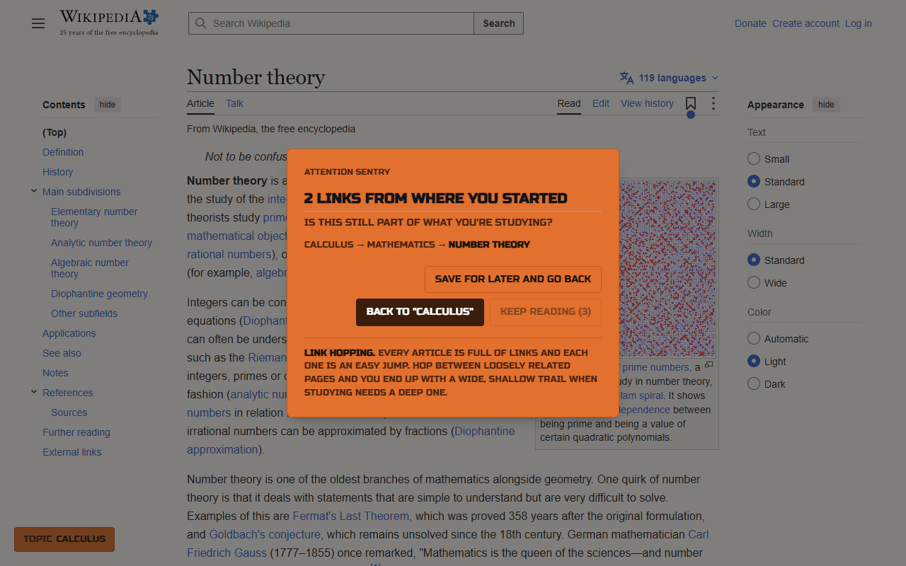
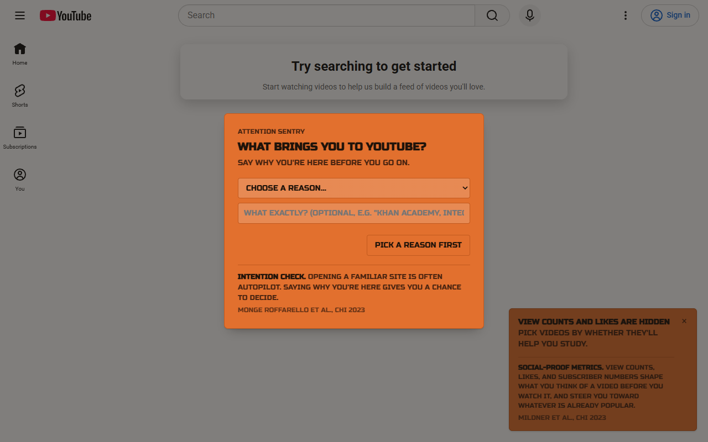
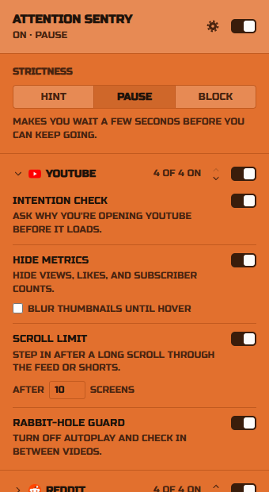

# Attention Sentry: Study Without Distraction

[](https://github.com/tomup5/AttentionSentry-ChromeExtension/actions/workflows/ci.yml)


[](LICENSE)

A Chrome extension for studying on YouTube, Reddit, Wikipedia, Discord, and The New York Times. When one of these sites uses a design pattern meant to hold your attention, like infinite scroll, autoplay, view counts, or daily games, the extension steps in and tells you which pattern it is.

The idea is that once you know what these patterns look like, you start noticing them yourself. The explanations are based on HCI research on dark patterns and attention capture (listed under Background).

| Catches a link-hopping trail on Wikipedia | Asks why you came, before the feed loads |
| :---: | :---: |
|  |  |

<p align="center">
  
</p>

## How it works

Each site has its own switch and collapsible section in the popup. Features that hide something do so at every strictness level; check-ins follow the strictness level:

| Mode | Behavior |
|---|---|
| **Hint** | Dismissible toasts that explain the pattern. Nothing is removed. |
| **Pause** | Modal overlays that pause playback, with short countdowns before you can continue. |
| **Block** | Removes the pattern: hides the sidebar, end screens, and Shorts shelves, and stops the feed from loading more. |

The main switch in the popup can always turn Attention Sentry off, even in Block mode.

**Distracting-site blocker.** While Attention Sentry is on, the sites you pick (TikTok, Instagram, Snapchat, X, Facebook, Tumblr, Twitch, Netflix, Pinterest, plus any you add) open an Attention Sentry page instead. The strictness level decides how hard they are to get past: Hint offers an "Open anyway" button, Pause makes you wait 15 seconds first, and Block keeps them closed until Attention Sentry is off. An unlocked site stays open for 5 minutes.

The settings page (gear icon in the popup) changes the font and background color used by the popup and every on-page prompt. It offers nine fonts, six color themes plus an automatic light or dark theme (which follows each site's own dark mode), eight accent colors, and three text sizes.

While you study, the popup shows a summary of the current tab's session on a supported site: your stated goal, how many videos or articles you've opened, and how long the tab has been on screen.

See [features by site](#features-by-site) for the full list.

## Installation

1. Clone this repository.
2. Open `chrome://extensions` and enable **Developer mode**.
3. Click **Load unpacked** and select the project folder.
4. Open the extension popup, turn on Attention Sentry, and visit one of the supported sites.

## Engineering decisions

- **Blocking without reading the page.** Distracting sites are blocked with `declarativeNetRequest` rules, so Chrome stops the load and the extension never sees those pages. Host access is optional and requested per site; without it a site is still blocked, just with Chrome's own error page.
- **Selectors that survive redesigns.** YouTube's view counts are matched by text ("1.2M views") because its class names and card components keep changing. Reddit's counts render inside shadow DOM, so a style is injected into each shadow root. Discord's generated class names are avoided in favor of data attributes and URLs.
- **No flash of hidden content.** YouTube's mutation handling is deliberately unthrottled: observer callbacks run before paint, so a count is tagged and hidden before it can appear. Sites without that requirement use a throttled observer.
- **One lifecycle for single-page apps.** `startSite()` separates a real page change from a settings change, so changing an accent color can't undo a feed that Block mode stopped.
- **State the page can't read.** Per-tab session data lives in `chrome.storage.session`, out of reach of the sites' own scripts, instead of the page's `sessionStorage`. User text only ever reaches the DOM through `textContent`.
- **No build step, and nothing to download.** The extension ships as the source you can read here, with fonts bundled instead of fetched from a CDN, so it makes no network requests. npm is used only for development tooling, and none of it ships.

## Architecture

```
 Popup ──writes──► chrome.storage.sync ──onChanged──► Content scripts (one per site)
                          │                                   │
                       onChanged                    closeTab / getTabId
                          ▼                                   │
                 Background worker ◄──────────────────────────┘
                          │
             declarativeNetRequest rules
                          ▼
            Blocked page (or Chrome's error page)
```

- **`popup/`**: settings UI, split into one script per part of the page. `popup.js` holds the settings and loads last. It writes to `chrome.storage.sync` and never messages the page directly. Sections are built from `SITE_SECTIONS` in `site-sections.js`.
- **`content/`**: injected into each supported site. Settings apply live through storage change events.
  - `site-runtime.js` holds `startSite()`, which runs each site's hooks at the right moments, plus shared page helpers and time tracking.
  - `session.js` is per-tab session state, with one slot per site.
  - `checkins.js` holds the prompts sites share: the intention check, goal badge, endless-scroll nudge, and count check-in.
  - `ui.js` and `ui.css` are a small site-agnostic toolkit for toasts and accessible modal overlays.
  - `techniques.js` holds the copy and citations for each design pattern.
  - `youtube.js`, `reddit.js`, `wikipedia.js`, `discord.js`, and `nyt.js` contain each site's feature logic, with a matching `.css` file for the hiding. Rules are scoped to classes toggled on `<html>`, so they also apply to content the site renders later.
- **`shared/`**: loaded by every context. `settings.js` is the schema and defaults, `common.js` the message types, storage keys, and DOM helper, `appearance.js` the fonts and themes, and `sites.js` the blockable sites and domain handling.
- **`background.js`**: closes tabs on request, gives content scripts their tab ID, and turns the blocking settings into `declarativeNetRequest` rules. Temporary unlocks live in `chrome.storage.session` and end with a `chrome.alarms` alarm.
- **`blocked/`**: the page shown in place of a blocked site. It reuses the overlay card from `content/ui.js`.

These sites change their markup regularly. Selectors each script depends on are kept in `SELECTORS` at the top of the site's `.js` file, and selectors used only for hiding live in its `.css` file.

## Development

Requires Node 22 or later. Nothing here is needed to run the extension.

```sh
npm install
npm test        # unit and integration tests
npm run lint    # ESLint, including cross-file globals
npm run check   # lint, formatting, and tests, as run in CI
```

The tests load the real, unmodified scripts in manifest order into [jsdom](https://github.com/jsdom/jsdom), with only the `chrome.*` APIs faked. The popup and blocked page are loaded from their real HTML.

To build the Chrome Web Store upload: `powershell -ExecutionPolicy Bypass -File scripts/package.ps1`.

## Features by site

**YouTube**

| Feature | Pattern addressed | What it does |
|---|---|---|
| **Intention check** | Opening YouTube on autopilot | Asks why you're here when a session starts; your answer stays pinned as a reminder |
| **Hide metrics** | Social proof | Hides view, like, and subscriber counts; optionally blurs thumbnails until hover |
| **Endless-scroll nudge** | Infinite scroll, Shorts | Intervenes after a configurable number of screens scrolled or Shorts watched |
| **Rabbit-hole guard** | Autoplay, recommendations | Turns autoplay off and checks in when you hop from video to video |

**Reddit**

| Feature | Pattern addressed | What it does |
|---|---|---|
| **Intention check** | Opening the feed on autopilot | Asks why you're here on the home, Popular, and All feeds. Opening a community or a post directly goes straight through |
| **Hide metrics** | Social proof | Hides upvotes, comment counts, member counts, and karma |
| **Endless-scroll nudge** | Infinite scroll | Same as YouTube's, for home, Popular, and community feeds |
| **Hide sidebars** | Discovery feeds | Hides Popular, All, Explore, Recent, and the right-hand column |

**Wikipedia**

| Feature | Pattern addressed | What it does |
|---|---|---|
| **Rabbit-hole tracker** | Link hopping | Tracks the trail of links you follow from your starting article and checks in after a set number of hops; a badge links back to where you started |
| **Save tangents** | Unfinished curiosity | Hovering a link offers "Save for later"; saved links are listed in the popup |
| **Hide Main Page extras** | Novelty | Hides Did you know, In the news, On this day, and Random article |

**Discord**

| Feature | Pattern addressed | What it does |
|---|---|---|
| **Study-channel focus** | Always-on chat | Mark the channels you study in; other channels are dimmed and check in when you open them |
| **Hide unread badges** | Notification badges | Hides mention counts and unread dots in the server list |

**The New York Times**

| Feature | Pattern addressed | What it does |
|---|---|---|
| **Intention check** | Opening the front page on autopilot | Asks why you're here on the front page; links straight to an article go through |
| **Games check** | Daily games and streaks | Steps in before Wordle, Connections, Spelling Bee, the Mini, and other games |
| **Article check-in** | Article chains | Checks in once you've read a set number of articles in one session |
| **Hide "More to read"** | Recirculation | Hides Most Popular, Trending, Editors' Picks, and recommended-article boxes |

## Privacy

Attention Sentry makes no network requests and collects no data. Its scripts run only on YouTube, Reddit, Wikipedia, Discord, and nytimes.com. Site blocking uses `declarativeNetRequest`, so Chrome does the blocking without the extension reading those pages; access to the blocked sites is optional and requested only for the sites you choose. Settings live in `chrome.storage.sync`. Per-tab session state (your stated intention, videos and articles opened, your Wikipedia trail) lives in `chrome.storage.session`, not the page's `sessionStorage`, so the sites' own scripts can't read it, and it's cleared when the tab closes. Saved Wikipedia links and Discord study channels stay in `chrome.storage.local` on your device. See the full [privacy policy](PRIVACY.md).

## Background

The pattern explanations draw on:

- Mildner, T., et al. "About Engaging and Governing Strategies: A Thematic Analysis of Dark Patterns in Social Networking Services." *CHI '23*. https://doi.org/10.1145/3544548.3580695
- Monge Roffarello, A., et al. "Defining and Identifying Attention Capture Deceptive Designs in Digital Interfaces." *CHI '23*. https://doi.org/10.1145/3544548.3580729
- Ambrosi, Dino. "The Battle for Your Time: Exposing the Costs of Social Media." TEDx Talks, 2023. https://www.youtube.com/watch?v=4TMPXK9tw5U
- Friends of Attention. *Attensity! A Manifesto of the Attention Liberation Movement*. Edited by D. Graham Burnett et al., Crown, 2026.
- Zhao, L. "Social Media Multitasking and College Students' Academic Performance." *Psychology in the Schools* 60(9), 2023. https://doi.org/10.1002/pits.22912

## License

[MIT](LICENSE)
